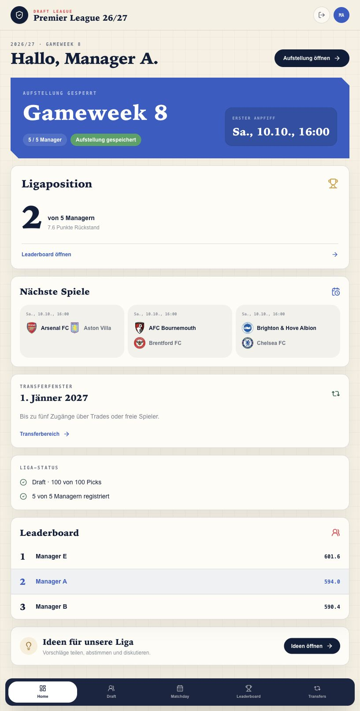
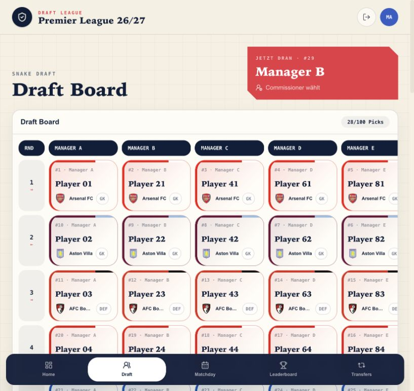
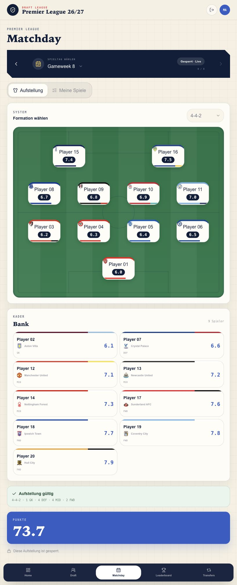
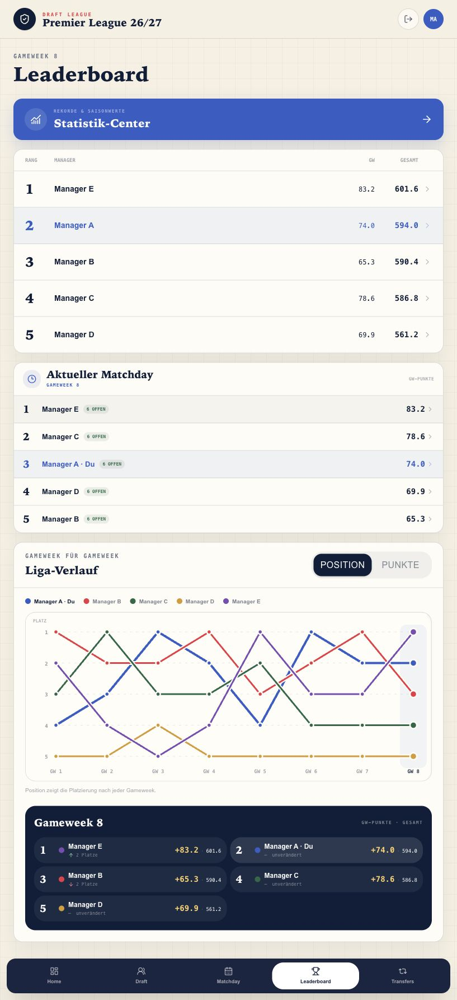

# Draft League · Premier League Draft Template

Eine private Fantasy-Fußball-Liga für **fünf Manager**: Spieler exklusiv draften, jede Gameweek die Startelf aufstellen und über die Saison um die höchste Gesamtwertung spielen.

**Next.js · React · TypeScript · Tailwind CSS · Supabase**



## Was kann die App?

| Bereich | Funktionen |
| --- | --- |
| **Private Liga** | Anmeldung mit Managername und Passwort, Beitritt über einen privaten Liga-Code; der erste Manager wird Commissioner. |
| **Snake Draft** | 20 Runden, 100 Picks, exklusive Spieler; Commissioner legt die Reihenfolge fest und führt die Picks aus. Suche und Positionsfilter im Spielerpool. |
| **Kaderregeln** | 20 Spieler: mindestens 2 Torhüter, 5 Verteidiger, 5 Mittelfeldspieler und 3 Stürmer; höchstens 4 Spieler pro Club. |
| **Aufstellung** | Elf eigene Spieler auf einem Spielfeld, acht Formationen, Bank und Gameweek-Wechsel. Bei fehlender Aufstellung wird vor der Wertung die letzte gültige Startelf übernommen. |
| **Spieltag** | Relevante Fixtures, Anstoßzeiten, Einzelwertungen und Verfügbarkeitsstatus. |
| **Leaderboard** | Saisonranking, Spieltagswertung, verbleibende Spieler und Verlauf der Platzierungen. |
| **Statistiken** | Saisonwerte, Rekorde, Bankpunkte und Vergleich mit der bestmöglichen Aufstellung. |
| **Commissioner** | Ligaeinstellungen, Draft-Reihenfolge, Gameweek-Status, zusätzliche Spieler und optionale Datenimporte. |
| **Ideen** | Vorschläge sammeln, abstimmen, kommentieren und als erledigt markieren. |
| **Transferübersicht** | Fenster, verbleibendes Kontingent, freie Spieler und vorhandene Trades ansehen. Transferaktionen sind noch nicht implementiert. |

Die Wertung basiert auf **Match-Ratings**, nicht auf FPL-Fantasy-Punkten. Bankspieler werden nicht automatisch eingewechselt. Die Oberfläche passt sich an Desktop und Smartphone an.

## Screenshots

Die Bilder zeigen die echte Oberfläche mit ausschließlich erfundenen Manager- und Ligadaten. Spielerbezeichnungen und Ergebnisse sind Beispieldaten.

| Draft Board | Aufstellung |
| --- | --- |
|  |  |



## In fünf Schritten starten

Du brauchst **Node.js 22+**, **pnpm** und ein **eigenes neues Supabase-Projekt**. Dieses Template enthält keine bestehenden Konten oder Ligadaten und startet ohne Datenbankkonfiguration nicht als Demo.

### 1. Repository kopieren

Auf GitHub **Use this template → Create a new repository** wählen, dein neues Repository klonen und im Projektordner ausführen:

```bash
pnpm install --frozen-lockfile
cp .env.example .env.local
```

### 2. Supabase verbinden

Im [Supabase Dashboard](https://supabase.com/dashboard) ein neues Projekt erstellen. Projekt-URL und **Publishable Key** aus dem Connect-Dialog in `.env.local` eintragen:

```dotenv
NEXT_PUBLIC_APP_URL=http://localhost:3000
NEXT_PUBLIC_SUPABASE_URL=https://your-project.supabase.co
NEXT_PUBLIC_SUPABASE_PUBLISHABLE_KEY=dein-publishable-key
```

Im SQL Editor den vollständigen Inhalt von [`supabase/schema.sql`](supabase/schema.sql) einmal ausführen. Das Schema enthält Tabellen, Row Level Security, Registrierungslogik und die Carry-forward-Erweiterung. Die Migration unter `supabase/migrations/` dient bereits bestehenden Installationen; für ein neues Projekt genügt das vollständige Schema.

Unter **Authentication → Providers → Email** die Option **Confirm email** ausschalten. Die App verwendet intern technische E-Mail-Adressen auf der reservierten Domain `manager.example.invalid`; Manager melden sich mit ihrem Namen an. Es werden keine E-Mails verschickt.

### 3. Eigene Liga anlegen

```bash
pnpm setup:league --name "Meine Liga" --season "2026/27"
```

Öffne die erzeugte Datei `.local/bootstrap.sql` privat. Sie enthält deine Liga-ID und einen zufälligen Liga-Code. Führe sie im SQL Editor deines Projekts aus. Die Datei bleibt durch `.gitignore` lokal.

### 4. Spieler und Spielplan importieren

Lade die JSON-Dateien der **aktuell von FPL angebotenen Saison** herunter. Die Saisonangabe aus Schritt 3 wählt keine historische Saison aus.

```bash
curl --fail https://fantasy.premierleague.com/api/bootstrap-static/ -o .local/bootstrap.json
curl --fail https://fantasy.premierleague.com/api/fixtures/ -o .local/fixtures.json
```

Ersetze `DEINE-LIGA-ID` durch die ID aus `.local/bootstrap.sql`:

```bash
pnpm setup:season --league DEINE-LIGA-ID --bootstrap .local/bootstrap.json --fixtures .local/fixtures.json
```

Führe `.local/season.sql` im SQL Editor aus. Der Import legt Spieler, Gameweeks und bekannte Fixtures mit Anstoßzeiten an. Die Gameweeks starten im Status `pending`. Vereinsnamen, Wappen und die Saisonbeschriftungen der Oberfläche sind derzeit auf 2026/27 ausgerichtet; für andere Saisonen [`lib/football/clubs.ts`](lib/football/clubs.ts), `public/clubs/` und die UI-Beschriftungen anpassen.

### 5. Spielen

```bash
pnpm dev
```

[localhost:3000/login](http://localhost:3000/login) öffnen und **den eigenen Account zuerst registrieren**. Du wirst Commissioner. Danach den privaten Liga-Code an die vier anderen Manager weitergeben. Sobald alle fünf registriert sind, beginnt der Draft. Gameweeks und das Transferfenster lassen sich im Commissioner-Bereich verwalten.

## Optionale Datenimporte

Die Commissioner-Oberfläche enthält Importe für Match-Ratings und Verletzungen. Diese benötigen die mitgelieferten Supabase Edge Functions; sie werden beim Start der Next.js-App nicht automatisch installiert.

| Funktion | Aufgabe |
| --- | --- |
| `import-sofascore-ratings` | Importiert aktuell FotMob-Ratings; der Funktionsname ist historisch. |
| `import-player-availability` | Importiert Verletzungs-/Verfügbarkeitsdaten aus SportsGambler. |

Die Funktionen prüfen die Anmeldung und Commissioner-Rolle. Backend-Schlüssel gehören ausschließlich in die Secrets deiner Edge Functions. Deploy- und Auth-Einstellungen anhand der aktuellen [Supabase-Anleitung](https://supabase.com/docs/guides/functions/deploy) konfigurieren. Datenquellen können ihre Oberfläche ändern; automatische Imports und eine dauerhaft kostenlose Verfügbarkeit sind nicht garantiert. Vor Nutzung die Zugangs- und Nutzungsbedingungen der Datenanbieter klären.

## Tests und Veröffentlichung

```bash
pnpm test
pnpm typecheck
pnpm build
pnpm security:check
```

Die Datenbanktests laufen isoliert mit PGlite. Sie benötigen keine Verbindung zu deiner Liga. `security:check` meldet typische Geheimnisse und private Dateien, ohne deren Inhalte auszugeben. GitHub Actions führt diese Prüfungen bei Pushes und Pull Requests aus.

Für ein Deployment das eigene Repository mit einem Next.js-kompatiblen Hoster verbinden, dieselben drei Umgebungsvariablen eintragen und `NEXT_PUBLIC_APP_URL` auf die eigene Domain setzen. In Supabase **Authentication → URL Configuration** die Site URL entsprechend einstellen. Eine Analyse-/Tracking-Integration ist in diesem Template nicht aktiviert.

Weitere Hinweise zu privaten Dateien und Produktgrenzen stehen in [`docs/SECURITY.md`](docs/SECURITY.md).

## Projektstruktur

```text
app/                 Seiten und API-Routen
components/          Draft, Aufstellungen, Ranglisten und Einstellungen
lib/                 Spielregeln, Datenzugriff und Tests
supabase/schema.sql  Vollständiges Schema für neue Projekte
supabase/functions/  Optionale Datenimporte
scripts/             Liga-Setup, Saisonimport und Prüfung öffentlicher Dateien
docs/screenshots/    Screenshots mit Beispieldaten
```

## Lizenz und fremde Inhalte

Für den eigenen Quellcode ist noch keine Lizenz festgelegt. Öffentlich sichtbarer Code erteilt allein keine allgemeine Nutzungslizenz. Vereinswappen, Marken und Daten externer Anbieter unterliegen ihren jeweiligen Rechten.
